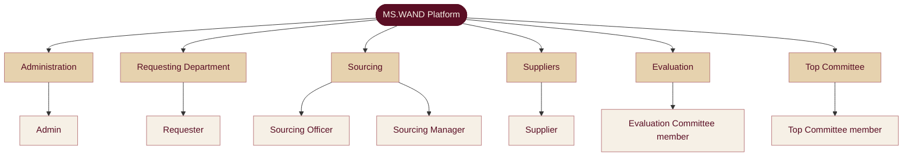
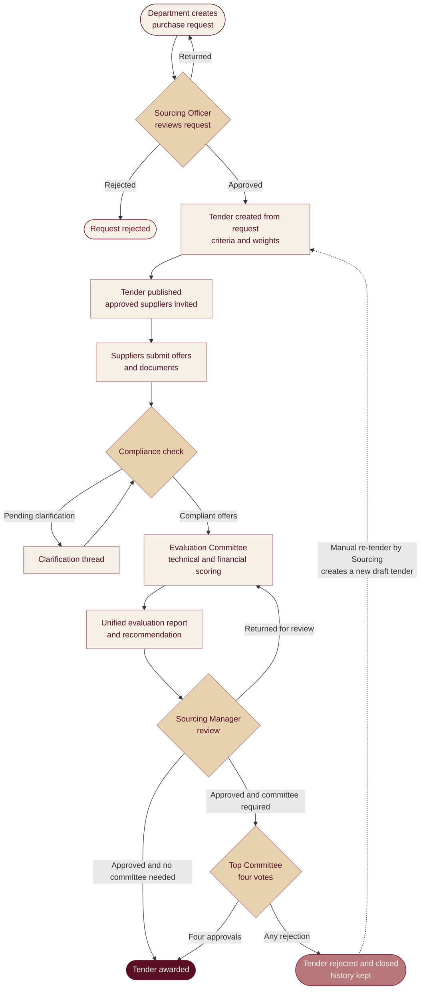
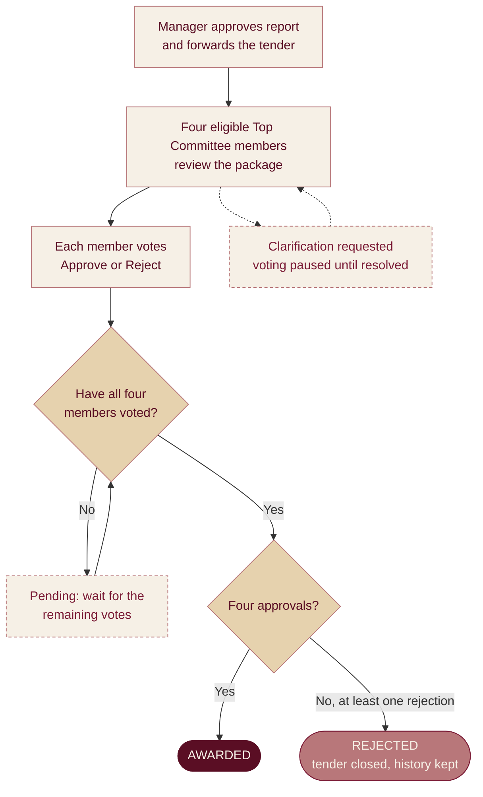
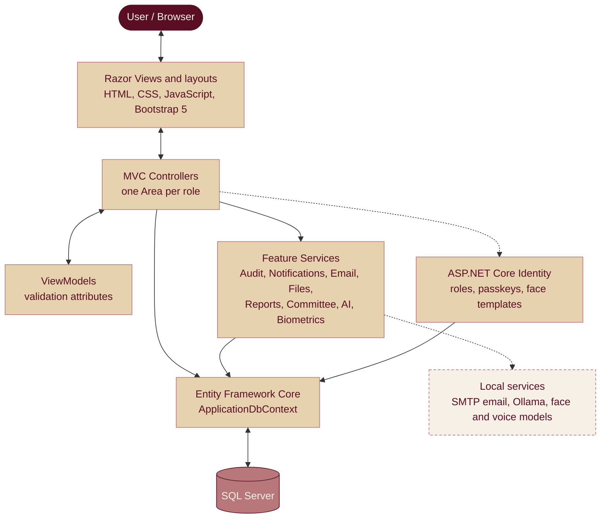
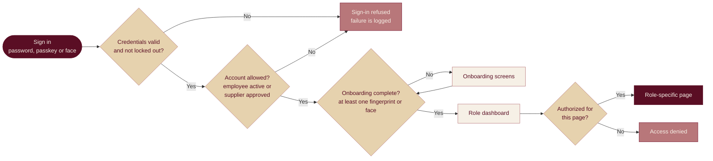

<div align="center">

# ✦ MS.WAND ✦

### Sourcing & Tender Management System

**From purchase request to final award: one transparent, role-based procurement workflow for a cosmetics company.**

**TRANSPARENCY · COLLABORATION · CONTROL**

<br>


<br>

[**Overview**](#project-overview) &nbsp;·&nbsp;
[**Problem & Solution**](#problem--solution) &nbsp;·&nbsp;
[**Features**](#key-features) &nbsp;·&nbsp;
[**Roles**](#system-roles) &nbsp;·&nbsp;
[**Workflow**](#complete-procurement-workflow) &nbsp;·&nbsp;
[**Voting**](#top-committee-voting-rules) &nbsp;·&nbsp;
[**Architecture**](#system-architecture) &nbsp;·&nbsp;
[**Stack**](#technology-stack) &nbsp;·&nbsp;
[**Security**](#security--authentication)

[**Brand**](#uiux-design--brand-identity) &nbsp;·&nbsp;
[**Getting started**](#getting-started) &nbsp;·&nbsp;
[**Setup**](#development-setup--environment-configuration) &nbsp;·&nbsp;
[**Developer guide**](#developer-guide--contribution-rules) &nbsp;·&nbsp;
[**Figma & Trello**](#project-design--management) &nbsp;·&nbsp;
[**Docs**](#additional-documentation) &nbsp;·&nbsp;
[**Team**](#development-team)

</div>

---

> [!IMPORTANT]
> **Developers and AI assistants: read [`AI_INSTRUCTIONS.md`](AI_INSTRUCTIONS.md) before touching any code.** Task IDs, owners and phases are in [`TASKS.md`](TASKS.md).

## Project Overview

**MS.WAND** is a web-based sourcing and tender management system built for a cosmetics company. It brings purchase requests, tender preparation, supplier participation, offer evaluation and final procurement decisions into one structured, role-based platform. Every team works in its own dashboard and sees only what its role allows, while the system keeps a record of the important actions taken along the way.

It is an **ASP.NET Core 10 MVC** application backed by **SQL Server** through Entity Framework Core, with ASP.NET Core Identity for accounts and roles. Users can sign in with a password, a passkey or on-server face recognition. Optional AI assistants can run on a local Ollama model, but humans make every decision. The project was designed, built and tested by a team of seven developers working in parallel on one repository.

## Problem & Solution

**The problem.** In many companies, buying raw materials, packaging and services runs through emails, spreadsheets and quotations in different formats. Requests get lost, suppliers are compared unevenly, and it is hard to show *who* decided *what*, and *why*.

**The solution.** MS.WAND carries every purchase through one auditable path:

1. A **department** raises a purchase request.
2. The **sourcing team** reviews it, turns it into a tender with criteria and weights, and invites approved suppliers.
3. **Suppliers** submit offers and supporting documents.
4. Sourcing checks **compliance**, then the **Evaluation Committee** scores each offer technically and financially and produces one unified report.
5. The **Sourcing Manager** reviews the recommendation and either awards the tender or, when the tender requires it, forwards it to the **Top Committee**, whose four members vote.

Each step has an owner, a status and a trail, so decisions can be explained afterwards.

## Key Features

| Module | What it does |
|---|---|
| **Purchase requests** | Departments prepare, save, submit and track requests with items and priority. Sourcing approves, rejects or returns them, and returned requests can be revised. |
| **Tender management** | Sourcing creates tenders from approved requests, sets evaluation criteria and weights, invites suppliers and tracks progress. A rejected tender can be re-tendered manually (see [Top Committee Voting Rules](#top-committee-voting-rules)). |
| **Supplier portal** | Suppliers register (the Admin reviews their documents), manage their company profile, answer invitations and submit offers with line items and documents. |
| **Compliance and comparison** | Sourcing checks each offer (Compliant, Non-Compliant or Pending Clarification) and compares offers side by side. |
| **Evaluation** | Assigned committee members score offers technically and financially, and the system builds a unified evaluation report with a recommendation. |
| **Manager review** | The Sourcing Manager approves, returns or forwards the committee recommendation. |
| **Top Committee** | Four eligible members review the package and vote on tenders that require a committee decision. |
| **Clarifications and notifications** | Role-based question-and-answer threads, in-app notifications and email for important events. |
| **Document protection** | Uploads are stored outside the web root under random names. Committee, manager and sourcing document previews are watermarked, and access is logged. |
| **Reports** | Filtered reports with Excel and PDF export. |
| **Audit log** | Important actions (sign-ins, status changes, decisions) are recorded and reviewed by the Admin. |
| **Administration** | Employee accounts, departments, evaluation-committee seats, supplier registrations (approve, reject, suspend) and contact messages. |
| **Assistants** | Optional AI chat, tender summaries and offer analysis, plus voice search. These are assistants only and never decide. |

> [!NOTE]
> A few screens are still placeholders without a workflow: Sourcing **Tenders › Suppliers**, Evaluation **Financial**, Top Committee **Decisions** and **Statistics**, and the public **How It Works** page. Everything else described in this README is implemented in the code.

## System Roles

MS.WAND has seven roles. Role names are defined once in [`Infrastructure/Roles.cs`](Project/TenderSystem/TenderSystem/Infrastructure/Roles.cs), and every area controller is protected with `[Authorize(Roles = ...)]`.



*The map shows who works where. The Sourcing Manager belongs to Sourcing but is not an evaluation or Top Committee member.*

| Role | Area | Primary responsibilities |
|---|---|---|
| **Admin** | `Areas/Admin` | Employee accounts, departments, committee seats, supplier registrations, contact messages, audit logs |
| **Requesting Department** | `Areas/Requester` | Create and track purchase requests, revise returned requests |
| **Sourcing Officer** | `Areas/Sourcing` | Review requests, create and publish tenders, invite suppliers, check compliance, compare offers, track evaluation, re-tender |
| **Supplier** | `Areas/Supplier` | Company profile and documents, invitations, prepare and submit offers |
| **Evaluation Committee** | `Areas/Evaluation` | Technical and financial assessment, recommendations, unified evaluation report |
| **Sourcing Manager** | `Areas/Manager` | Review evaluation reports and decide; forward to the Top Committee when required |
| **Top Committee** | `Areas/Committee` | Review the package and vote on the final decision |
| **Every signed-in user** | `Areas/Shared` | Onboarding, profile and security, notifications, clarifications, reports |

## Complete Procurement Workflow

The diagram follows the status values defined in [`Infrastructure/Statuses.cs`](Project/TenderSystem/TenderSystem/Infrastructure/Statuses.cs). It shows the main journey; smaller checks and error paths are handled inside each module.



<details>
<summary><b>Status values used along the way</b></summary>

<br>

| Entity | Statuses |
|---|---|
| Purchase request | Draft · Submitted · Under Review · Approved · Rejected · Returned · Converted to Tender |
| Tender | Draft · Published · Open · Closed · Under Evaluation · Awaiting Manager Review · Awaiting Committee Decision · Awarded · Cancelled · Rejected |
| Offer (bid) | Draft · Submitted · Under Review · Compliant · Non-Compliant · Accepted · Rejected · Withdrawn |
| Compliance result | Compliant · Non-Compliant · Pending Clarification |
| Evaluation report | Recommendation Pending · Manager Approved · Manager Rejected · Returned for Review · Committee Approved · Committee Rejected |
| Supplier | Pending · Approved · Rejected · Suspended |
| Clarification | Pending · Answered · Resolved |

</details>

## Top Committee Voting Rules

A tender that is flagged as requiring the Top Committee goes to a final vote after the Sourcing Manager approves the evaluation report. The committee voting and decision services enforce these rules:

- **Four eligible members.** The Top Committee is fixed at exactly four active accounts that hold the Top Committee role.
- **Two choices.** Each member votes **Approve** or **Reject**, independently. Votes and reasons stay private; the audit log records only the outcome and the tally.
- **Wait for all four.** No decision is recorded until all four votes are in. Until then the tender stays *Awaiting Committee Decision*.
- **Four approvals mean Awarded.** The recommended supplier is awarded the tender.
- **Any rejection means Rejected.** After the fourth vote, one or more rejections close the tender as *Rejected*. The bids, the evaluation report and all history are kept.
- **Clarifications are separate from voting.** A committee member can raise a clarification request instead of voting. While such a request is open, voting for that tender is paused until the Sourcing Manager resolves it. A clarification is never counted as a vote.



*Voting waits for all four members. Only a unanimous approval awards the tender.*

| Member 1 | Member 2 | Member 3 | Member 4 | Result |
|:---:|:---:|:---:|:---:|:---|
| Approve | Approve | Approve | Approve | 🟢 Awarded |
| Approve | Approve | Approve | Reject | 🔴 Rejected |
| Approve | Reject | Approve | Reject | 🔴 Rejected |
| Approve | Approve | Pending | Pending | 🟡 Pending, waiting for the remaining votes |

**After a rejection.** The rejected tender stays closed and the committee never creates a new tender by itself. Authorized Sourcing staff (the Sourcing Officer) may start a separate, manual **re-tender**, which creates a new draft tender for the same request. Only the latest rejected tender of a request can be re-tendered.

**If all four votes are in but the decision cannot be recorded** (for example the recommended offer is no longer eligible), the votes are kept, the reason is shown, and a member can retry.

## System Architecture

MS.WAND is a classic **ASP.NET Core MVC** application. Razor views render the interface, controllers handle requests, view models carry data between them, and Entity Framework Core reads and writes SQL Server. Each role has its own **Area** with its own controllers, views and view models. Business logic that several controllers share lives in `Services/<Feature>/`, and each feature registers itself through an `IFeatureModule` class instead of editing `Program.cs`.



*Controllers use `ApplicationDbContext` directly for ordinary CRUD. A service class exists only when logic is shared or long.*

<details>
<summary><b>Project folder structure</b></summary>

<br>

```text
Cosmetics-Management-System/              git repo root (.gitignore lives here)
  AI_INSTRUCTIONS.md  TASKS.md            rules and task ownership (read first)
  docs-site/                              team documentation website and database design
  Project/TenderSystem/
    TenderSystem.slnx
    TenderSystem/                         the web project
      .env.example                        copy to .env (never committed)
      Program.cs
      Areas/        Admin, Requester, Sourcing, Supplier, Evaluation, Manager, Committee, Shared
      Controllers/  public pages, account, passkey, face, AI endpoints, supplier documents
      Views/        Home, Account, Shared (layouts and one sidebar per role)
      Data/         ApplicationDbContext, Entities, DbSets, Configurations, Seed
      Infrastructure/  Roles, Statuses, options, DashboardRouter
      Services/     Ai, Audit, Auth, Biometrics, Clarifications, Committee, Email,
                    Files, Notifications, Reports, Voice
      Migrations/   generated by EF Core (created only by the lead)
      wwwroot/      css, js, images
```

Layouts: `_PublicLayout` (navbar and large footer) is used by everything in `Views/`. `_DashboardLayout` (sidebar, header and small footer) is applied automatically to everything under `Areas/`. `_AuthLayout` is used for sign-in and supplier registration.

</details>

## Technology Stack

| Layer | Technology |
|---|---|
| **Platform** | .NET 10, ASP.NET Core MVC with Areas, Razor views, C# |
| **Data** | Entity Framework Core 10, Microsoft SQL Server (LocalDB or Express for development) |
| **Identity and security** | ASP.NET Core Identity, Fido2 (passkeys / WebAuthn), FaceAiSharp with ONNX Runtime (local face recognition) |
| **UI** | Bootstrap 5, Bootstrap Icons, Cairo font |
| **Documents and reports** | DocumentFormat.OpenXml (Excel), Aspose.PDF (PDF), PdfPig (reading offer documents) |
| **Messaging** | MailKit (SMTP email) |
| **Voice and AI** | Whisper.net (voice search transcription), Ollama (local model, optional) |
| **Configuration** | DotNetEnv (`.env` file) |
| **Collaboration** | Git and GitHub |

Package versions are pinned in [`TenderSystem.csproj`](Project/TenderSystem/TenderSystem/TenderSystem.csproj).

## Security & Authentication

Users sign in with a **password**, a **passkey** (fingerprint, Face ID or Windows Hello) or **face recognition**. Every request is then checked against the user's role.



*The flow combines authentication (who you are) and authorization (what you may open).*

| Mechanism | What is stored | Notes |
|---|---|---|
| **Password** (ASP.NET Core Identity) | Hashed password | Five failed attempts lock the account for 15 minutes; the lockout is shared with the other sign-in methods |
| **Passkeys** (Fido2 / WebAuthn) | Public key and a counter only | The fingerprint never leaves the device |
| **Face sign-in** (local AI) | Encrypted face template (AES-256-GCM) | **No picture is ever saved**; processing happens on our own server |

**Access control**

- **Role-based authorization.** Every area controller carries an `[Authorize(Roles = ...)]` attribute using the constants in `Infrastructure/Roles.cs`; the Shared area allows any signed-in user.
- **Supplier approval.** A supplier can sign in only after the Admin approves the registration. Pending, rejected and suspended suppliers are refused, and disabled employee accounts cannot sign in.
- **Supplier isolation.** A supplier must never see another supplier's offer, price or documents. Queries filter by the current supplier on the server and never trust an id from the URL alone.
- **Mandatory biometrics.** Before any dashboard opens, every user completes onboarding with **at least one** of fingerprint or face. The last remaining sign-in method cannot be removed.
- **Document protection.** Uploads follow the allowed extensions and size from `.env`, use random stored names and live under `App_Data/uploads`, never inside `wwwroot`. Downloads are access-controlled and logged.
- **Safe forms.** Server-side validation with Data Annotations and `[ValidateAntiForgeryToken]` on every POST are project rules for all features.
- **Audit trail.** Sign-ins, status changes, decisions and AI actions are written to the audit log.
- **AI is an assistant.** AI output is labelled as such. An AI-proposed action needs a fresh fingerprint or face approval from the Admin who asked, runs once and is audited. A hosted AI provider receives no data unless `AI_CHAT_DATA_WITH_API=true` is set.

<details>
<summary><b>Face sign-in: how to use it, and why we built our own</b></summary>

<br>

**How to use it**

- **Enroll.** Sign in with your password, open `https://localhost:7180/Face`, press **Start face setup** and follow the instructions (straight, turn to one side, turn to the other). A protected template is saved, never a photo.
- **Sign in.** On the login page leave the email empty ("smart" mode), press **Sign in with face** and look straight at the camera for about two seconds. A small anti-photo model checks the face is live; if it is not sure, the camera asks for one head turn to a random side. Type your email first for the strictest one-to-one check.
- **Safeguards.** Smart mode refuses ambiguous matches (two similar faces) and throttles failed attempts per client address. It can be turned off with `FACE_ALLOW_IDENTIFY=false`, and `FACE_LOGIN_TURNS=1` asks for one random side only.
- **HTTPS required.** The camera works only on `https://` pages or `localhost`. For a phone, see [Testing on a phone](#testing-on-a-phone-public-tunnel).
- **Tuning.** If real people are rejected or accepted wrongly, adjust `FACE_MATCH_THRESHOLD`, `FACE_YAW_TURN_MIN` and `FACE_YAW_CENTER_MAX` in `.env` and tell the lead the numbers.
- **Packages.** `FaceAiSharp.Bundle` (detector, landmarks and ArcFace models, CPU only) and `Microsoft.ML.OnnxRuntime`. `SixLabors.ImageSharp` is used under its Six Labors Split License (free for open source and non-commercial use).

**Why our own face recognition instead of a cloud service such as Face++**

| | Cloud service | Our own (local) |
|---|---|---|
| Where faces are processed | On the vendor's servers; pictures travel over the internet | On our server; faces never leave it |
| What is stored | Depends on the vendor | Only an encrypted list of 512 numbers; no picture |
| Needs | Account, API key, internet, usage limits or a paid plan | Nothing external; no key, no cost, works offline |
| Privacy and law | Face images go to a third party: consent, data residency and contract questions | Biometric data stays in our own database under our control |
| Anti-photo protection | Strong anti-spoofing is usually a separate commercial product | A real head movement is checked on the server (one-time challenge) |

**Honest limits**

- It is a challenge-response liveness check, not a certified one. A replayed **video** of the real person turning could pass. A commercial liveness product (3D, depth or infrared) is stronger.
- Camera and lighting change the similarity, so thresholds must be tuned with the real team and real phones.
- In smart mode, the more people are enrolled, the higher the chance of a wrong match. Raise `FACE_IDENTIFY_THRESHOLD` or ask for the email when the user base grows.
- Face data is personal data: keep the consent step in onboarding and a way to delete saved faces.

</details>

<details>
<summary><b>Fingerprint sign-in (passkeys): how to use it and its limits</b></summary>

<br>

- **Set up.** Sign in with your password, open `https://localhost:7180/Passkey` and press **Set up on THIS device** (Windows Hello, Touch ID, phone fingerprint) or **Use my PHONE** (a QR code appears and you approve on the phone). Give the device a name. You can add several devices and remove any of them on the same page.
- **Sign in.** On the login page press **Sign in with fingerprint**. No email is needed: the device offers your passkey and you unlock it.
- **What is stored.** Only a public key and a counter. The fingerprint itself never leaves the device.
- **Address matters.** A passkey belongs to the address it was created on, so `localhost` and a tunnel link are different and need separate setup. In Development the app reads the address from the page; elsewhere it uses `PUBLIC_URL`.
- **Limits.** The browser cannot say which biometric was used. A laptop without a fingerprint reader asks for the Windows Hello PIN or face instead, and a device with no screen lock refuses to create a passkey.
- **Testing status.** Registration, sign-in and several attacks (wrong site, phishing origin, replay, cloned key, tampered signature, missing user verification) were tested with a software authenticator. A real fingerprint reader and a real phone still have to be tried by the team.

</details>

<details>
<summary><b>Local AI processing (Ollama)</b></summary>

<br>

The AI assistant, tender summaries and offer analysis are controlled from `.env`. `AI_CHAT_PROVIDER` can be `off`, `ollama` (a local model through `OLLAMA_BASE_URL` and `OLLAMA_MODEL`) or `openai` (any hosted API that speaks the OpenAI chat format). **If the key is not set, the chat is off.** The example file selects Ollama. AI output is an assistant only and the interface says so. Details are in [`Services/Ai/README.md`](Project/TenderSystem/TenderSystem/Services/Ai/README.md).

</details>

## UI/UX Design & Brand Identity

The interface combines an enterprise workflow with a warm, cosmetics-inspired visual identity. It uses Bootstrap 5, Bootstrap Icons and the Cairo font, with clear status labels, responsive layouts and role-specific dashboards.

| Color | Hex | Use |
|---|---|---|
|  **Burgundy** | `#5A0E24` | Primary branding |
|  **Deep Burgundy** | `#7A1A35` | Navigation and emphasis |
|  **Rose Gold** | `#B8777A` | Accents |
|  **Champagne** | `#E6D2AE` | Highlights |
|  **Ivory** | `#F6F0E6` | Light backgrounds |

Screens are designed first as mockups and a clickable prototype (see [Project Design & Management](#project-design--management)). For implementation, developers use the palette CSS variables in `site.css` instead of hard-coding colors.

## Getting Started

**Requirements:** the **.NET 10 SDK**, **SQL Server** (LocalDB ships with Visual Studio, or use Express) and **Git**. Visual Studio or Visual Studio Code is recommended.

```bash
git clone https://github.com/Supply-Tender-Team/Cosmetics-Management-System.git
cd Cosmetics-Management-System/Project/TenderSystem/TenderSystem

cp .env.example .env            # PowerShell: Copy-Item .env.example .env
#   open .env and check that DB_CONNECTION matches YOUR SQL Server

dotnet dev-certs https --trust  # once per machine (passkeys and camera need HTTPS)
dotnet tool install --global dotnet-ef
dotnet run --launch-profile https
```

> [!WARNING]
> **In Development, starting the app changes your local database.** On startup it applies pending EF Core migrations (creating the database if it does not exist) and, depending on the `SEED_*` settings in `.env`, creates test accounts and demo data. Point `DB_CONNECTION` at a **local development database only**.

Open **https://localhost:7180** (the plain HTTP address is `http://localhost:5180`). Everybody uses the same port so WebAuthn behaves the same on every machine.

In Development with test accounts enabled, the login page shows one-click buttons for each role (Admin, Requesting Department, Sourcing Officer, Evaluation Committee, Sourcing Manager, Top Committee, Supplier). The test accounts and their password come from the `SEED_*` keys in `.env.example`; never create real credentials in code.

**Visual Studio:** open `Project/TenderSystem/TenderSystem.slnx`, select the **https** profile and press **F5**.

You do **not** edit `appsettings.json`, `launchSettings.json` or the `.csproj`. Your only local configuration file is `.env`.

## Development Setup & Environment Configuration

### The `.env` file

`.env` holds settings that differ per machine or are secret. It is read at startup (DotNetEnv), lives next to `Program.cs`, and is **never committed** (it is in `.gitignore`). `.env.example` is committed and lists every key with a safe example value. Copy it once and edit your own values.

| Group | Keys | Purpose |
|---|---|---|
| Database | `DB_CONNECTION` | SQL Server connection string for your machine |
| Public address | `PUBLIC_URL` | The one place that holds the site address; email links and WebAuthn settings derive from it |
| Seeding | `SEED_TEST_USERS`, `SEED_DEMO_DATA`, `SEED_*` | Development test accounts and demo data |
| Passkeys | `WEBAUTHN_RP_NAME`, `WEBAUTHN_MAX_FAILURES` | WebAuthn settings |
| Face | `FACE_*` | Thresholds, liveness, encryption key for face templates |
| Uploads | `UPLOAD_ROOT_PATH`, `UPLOAD_MAX_MB`, `UPLOAD_ALLOWED_EXTENSIONS` | File upload rules |
| Email | `SMTP_ENABLED`, `SMTP_*` | With `SMTP_ENABLED=false`, emails are saved as HTML files under `App_Data/emails` instead of being sent |
| AI | `AI_CHAT_PROVIDER`, `AI_ACTIONS`, `OLLAMA_BASE_URL`, `OLLAMA_MODEL` | Optional assistants |

> [!CAUTION]
> Never commit `.env`, passwords, API keys, encryption keys or tunnel links with real secrets. Never hard-code `localhost`, a port or a tunnel link in C#, views or JavaScript: use `PUBLIC_URL`. If you ever commit a secret by mistake, tell the lead immediately; the secret must be changed, deleting the file is not enough.

### HTTPS and local addresses

Passkeys and the camera need a secure context, so run with the **https** launch profile after `dotnet dev-certs https --trust`. Local addresses are `https://localhost:7180` and `http://localhost:5180`. In Development, `https://localhost:7180/dev/public-url` shows the address that emails and passkeys will use.

### Testing on a phone (public tunnel)

Fingerprint and face sign-in need HTTPS and a real host name. On your laptop `https://localhost:7180` is enough. For a phone, open a free Cloudflare tunnel:

```bash
winget install Cloudflare.cloudflared      # once
cloudflared tunnel --url http://localhost:5180
```

It prints a link such as `https://random-words.trycloudflare.com`. Then:

1. Put that link in `.env` as `PUBLIC_URL=https://random-words.trycloudflare.com` (the only value to change).
2. Restart the app and open the link on the phone.
3. Check it on your own machine at `https://localhost:7180/dev/public-url`.

The link changes every time you start the tunnel, so update `PUBLIC_URL` again and register passkeys again. Share the link only with teammates. Through a tunnel the one-click sign-in panel and the `/dev/*` pages are hidden on purpose. To go back to normal, set `PUBLIC_URL=https://localhost:7180`.

### Database and migrations

The database design is in [`docs-site/database/schema.sql`](docs-site/database/schema.sql). Entities must match it. **Only the lead creates and commits migrations.** If you change an entity you own, push your branch without any `Migrations/` file and tell the lead. In Development the app applies new migrations at startup, or run `dotnet ef database update`.

## Developer Guide & Contribution Rules

Seven developers work in parallel on one repository, so the project uses one shared way of working to avoid merge conflicts. The authoritative rules are in [`AI_INSTRUCTIONS.md`](AI_INSTRUCTIONS.md) and the task plan is in [`TASKS.md`](TASKS.md); where this summary differs, those files win. Who owns which area is listed in [Development Team](#development-team).

<details open>
<summary><b>Golden rules</b></summary>

<br>

1. **Never touch another person's code.** Edit only the files that belong to your task.
2. **Only add, do not rewrite.** No renaming, moving, reformatting or "cleaning up" files you did not create.
3. **Keep it simple.** A normal controller, a simple ViewModel, a simple entity and, only when needed, a simple service class. No generic repositories, Unit of Work, MediatR, CQRS or AutoMapper.
4. **Shared files are read-only** unless you are the owner: `Program.cs`, `*.csproj`, `appsettings*`, `Infrastructure/*`, `Data/ApplicationDbContext.cs`, `Views/Shared/*`, shared CSS and JS, `.gitignore`, `AI_INSTRUCTIONS.md`, `TASKS.md` and `README.md`.
5. **No new NuGet packages** without asking the lead.
6. **Never commit secrets or machine files** (`.env`, `bin/`, `obj/`, `.vs/`, uploads).
7. **When unsure, ask.** A question is cheaper than a conflict.

</details>

<details open>
<summary><b>Where does my work go?</b></summary>

<br>

```text
Areas/<Role>/Controllers, Views, Models         one folder per role dashboard
Controllers/ and Views/Home, Views/Account      public pages and sign-in
Views/Shared/                                   layouts and sidebars (shared file)
Data/Entities/<Feature>/                        your entity classes
Data/DbSets/ApplicationDbContext.<Feature>.cs   your DbSet properties (never edit ApplicationDbContext.cs)
Data/Configurations/                            IEntityTypeConfiguration<T> mapping files (ask the lead)
Services/<YourFeature>/                         your services plus one IFeatureModule class
Migrations/                                     generated by EF Core, created only by the lead
```

Register services in your own `IFeatureModule` class, never in `Program.cs`.

</details>

<details open>
<summary><b>Git workflow and checks before you ship</b></summary>

<br>

- Create **one branch per task from `dev`**, named after the task ID: `feature/<ID>-<short-name>` or `fix/<ID>-<short-name>` (for example `feature/SUP-04-submit-offer`).
- **Never commit or push directly to `dev` or `main`, and never force-push.** Push your branch and open a pull request **into `dev`**. A teammate reviews and the lead merges; only the lead merges `dev` into `main`.
- Commit small and often, with the message format `<ID>: <what you did>`. Pull request titles use `[<ID>] <what>`.
- Pull `dev` into your branch every morning. Before each commit run `git status` and `git diff` and check that only your files changed.
- Before you call a page done: keep `[Authorize(...)]` on your controller, use `Infrastructure/Statuses.cs` constants instead of raw strings, run `dotnet build` with zero errors, and test the normal path and one invalid-input path.
- Use the shared services instead of copying them: `AuditService`, `NotificationService`, `FileStorageService`, `EmailService`, `AiBidAnalysisService`.

</details>

## Project Design & Management

The interface design and the team's task planning live in two shared workspaces, so the screens, the code and the work plan stay aligned.

<div align="center">

[](https://www.figma.com/design/THQWvk7lJmeY6CuJL6hZxL/MS.WAND-%E2%80%94-Mockups---Prototype?node-id=0-1&t=i7FNNTrBfM19xFFj-1)
&nbsp;
[](https://trello.com/b/9QmwEScR/supply-tender-team)

</div>

| Workspace | What it is for |
|---|---|
| 🎨 **Figma: UI/UX Design & Prototypes** | The MS.WAND mockups, visual design and clickable prototype. Designers and developers use it to review screens, agree on the look of each role dashboard and collaborate on design changes before implementation. |
| 📋 **Trello: Project Tasks & Sprint Management** | The Supply Tender Team board for task planning, team coordination and sprint progress. Task IDs and ownership on the board are mirrored in [`TASKS.md`](TASKS.md). |

> Access to both workspaces may require an invitation from the project team.

## Additional Documentation

| Resource | Contents |
|---|---|
| [`AI_INSTRUCTIONS.md`](AI_INSTRUCTIONS.md) | How the team works: ownership, shared files, `.env`, UI rules, migrations, Git workflow, security rules |
| [`TASKS.md`](TASKS.md) | Every task, owner, phase and dependency |
| [`docs-site/SourcingTender-Docs.html`](docs-site/SourcingTender-Docs.html) | Team documentation website (open in a browser): schema, ER diagram, SQL, flow story, pages |
| [`docs-site/database/schema.sql`](docs-site/database/schema.sql) | Database design: table and column names to follow |
| [`Services/Ai/README.md`](Project/TenderSystem/TenderSystem/Services/Ai/README.md) | AI assistant, providers and the propose, approve, execute-once pipeline |
| [`Services/Reports/HANDOFF.md`](Project/TenderSystem/TenderSystem/Services/Reports/HANDOFF.md) | Reports module notes and Excel/PDF export |
| [`.env.example`](Project/TenderSystem/TenderSystem/.env.example) | Every configuration key with a safe example value |

## Development Team

Seven developers worked in parallel on one repository, combining **analysis, design, development, testing and integration** to deliver a complete procurement workflow. Each developer owns separate files so changes do not collide; the detailed per-folder ownership is in [`AI_INSTRUCTIONS.md` § 4](AI_INSTRUCTIONS.md#4-who-owns-what).

| Developer | Responsibility |
|---|---|
| **Wadea** (lead) | Platform, whole authentication, database foundation and migrations, email, biometrics, AI service, merging; owns `README.md` and the shared files |
| **Abdallah** | Admin area, Contact Us, voice search |
| **Dana** | Requester, Manager and Top Committee areas |
| **Nada** | Home pages, Sourcing dashboard, requests and tenders |
| **Deyaa** | Layout and UI kit, notifications, clarifications, Sourcing offers, compliance and evaluation tracking |
| **Marwa** | Demo data, audit, reports, Evaluation committee |
| **Sara** | Onboarding, Supplier area, uploads, watermark |

---

<div align="center">

<sub>© 2026 MS.WAND · Academic Software Project</sub>

</div>
