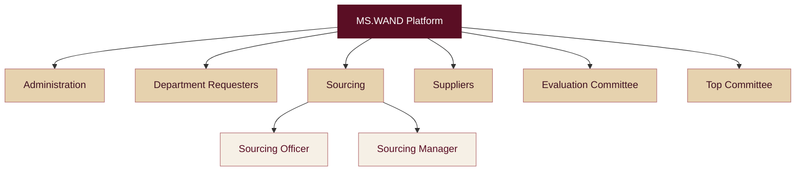
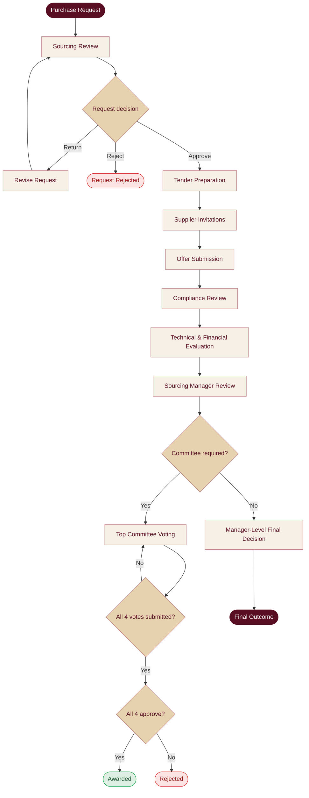
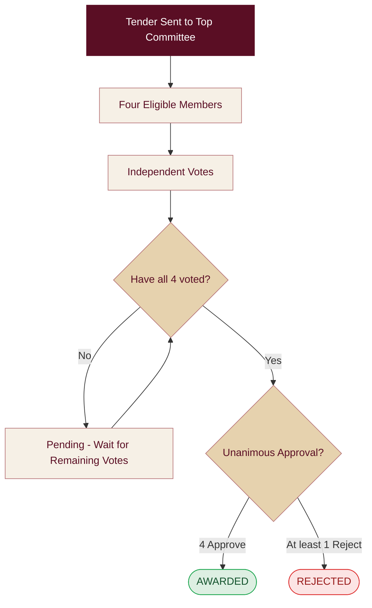
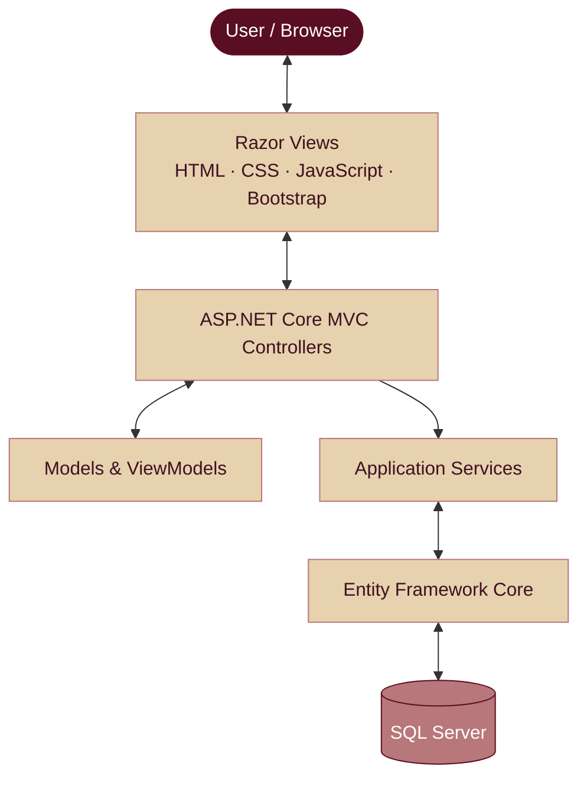
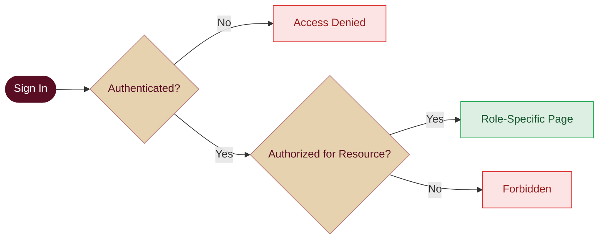

# ✦ MS.WAND ✦
### SOURCING & TENDER MANAGEMENT SYSTEM

**A Role-Based Procurement Platform for a Cosmetics Company**

*From Purchase Request to Final Award*

**TRANSPARENCY · COLLABORATION · CONTROL**

[Overview](#-overview) · [Features](#-key-features) · [Roles](#-system-roles) · [Workflow](#-procurement-workflow) · [Architecture](#-system-architecture) · [Getting Started](#-getting-started) · [Design & Management](#-project-design--management)

---

## ✦ Overview

**MS.WAND** is a web-based sourcing and tender management system designed for a cosmetics company. It brings purchase requests, tender preparation, supplier participation, offer evaluation, and procurement decisions into one structured, role-based platform.

The platform helps different teams collaborate while maintaining visibility into procurement progress and a record of important actions.

| 🔐 Security | 🔄 Efficiency | 🤝 Collaboration | 📋 Accountability |
|:---:|:---:|:---:|:---:|
| Role-based access | Organized procurement stages | Connected teams and suppliers | Traceable activities and decisions |

## ✦ Key Features

| Module | What it does |
|---|---|
| 📝 **Purchase Requests** | Departments prepare, save, submit, and track requests; eligible returned requests can be revised. |
| 📦 **Tender Management** | Sourcing prepares tenders, coordinates invitations, and tracks procurement activity. |
| 🚚 **Supplier Portal** | Suppliers manage invitations, submit offers, and follow relevant outcomes. |
| 🧪 **Evaluation** | Assigned committee members review proposals and supporting materials, score offers, and contribute to recommendations. |
| 💼 **Manager Review** | The Sourcing Manager reviews evaluation results and recommendations. |
| 🏛️ **Top Committee** | Four eligible members vote on tenders that require committee decisions. |
| 🔔 **Notifications** | Relevant participants receive system updates. |
| 📜 **Audit Logs** | Authorized administrators review recorded activities. |
| 👑 **Administration** | Admins manage employees, departments, supplier reviews, contact messages, and system records. |

## ✦ System Roles

| Role | Primary responsibility |
|---|---|
| **Admin** | Manage employee accounts, departments, supplier status, and administrative records. |
| **Department Requester** | Create and track purchase requests. |
| **Sourcing Officer** | Prepare tenders and coordinate supplier invitations and offers. |
| **Sourcing Manager** | Review evaluation recommendations and relevant tender decisions. |
| **Evaluation Committee** | Review and score assigned supplier proposals. |
| **Top Committee** | Vote on qualifying tenders. |
| **Supplier** | Respond to invitations and submit proposals. |

### Role Map

## ✦ Procurement Workflow

The following diagram illustrates the **main procurement journey**. Additional checks, return paths, and exceptions are handled within the relevant modules.

## ✦ Top Committee Voting

For tenders requiring Top Committee approval, **four eligible members** participate in independent voting. Members choose **Approve** or **Reject**. The system waits for **all four votes** before determining the final outcome.

| Member 1 | Member 2 | Member 3 | Member 4 | Result |
|:---:|:---:|:---:|:---:|:---|
| Approve | Approve | Approve | Approve | 🟢 Awarded |
| Approve | Approve | Approve | Reject | 🔴 Rejected |
| Approve | Reject | Approve | Reject | 🔴 Rejected |
| Approve | Approve | Pending | Pending | 🟡 Pending |

> **Clarification requests are separate from voting.** A Top Committee rejection closes the tender under the current agreed decision rules.

## ✦ System Architecture

MS.WAND uses **ASP.NET Core MVC**, with Razor Views for the interface, controllers for request handling, models and application services for data and logic, and Entity Framework Core for SQL Server access.

### Technology Stack

| Layer | Technology |
|---|---|
| Application platform | .NET 10 |
| Web framework | ASP.NET Core MVC |
| Language | C# |
| Views | Razor, HTML, CSS, JavaScript |
| UI | Bootstrap 5 |
| ORM | Entity Framework Core |
| Database | Microsoft SQL Server |
| Authentication | ASP.NET Core Identity |
| Additional authentication | Passkeys / WebAuthn |
| Collaboration | Git & GitHub |

## ✦ Security & Access Control

- Role-based authorization limits access to relevant modules and operations.
- ASP.NET Core Identity manages authentication and user accounts.
- Supplier approval status controls supplier access.
- Server-side validation and antiforgery protection support safe form processing.
- Audit records support accountability for recorded actions.

## ✦ User Interface & Brand Identity

The interface combines an enterprise workflow with a warm, cosmetics-inspired visual identity.

| Color | Hex | Use |
|---|---|---|
| **Burgundy** | `#5A0E24` | Primary branding |
| **Deep Burgundy** | `#7A1A35` | Navigation and emphasis |
| **Rose Gold** | `#B8777A` | Accents |
| **Champagne** | `#E6D2AE` | Highlights |
| **Ivory** | `#F6F0E6` | Light backgrounds |

The design emphasizes readable typography, clear status labels, responsive layouts, and role-specific dashboards.

## ✦ Getting Started

### Prerequisites

- .NET 10 SDK
- SQL Server or a compatible LocalDB setup
- Git
- Visual Studio or Visual Studio Code

### Local Setup

1. Clone the repository and open the solution.
2. Configure the required environment settings and database connection using the repository's documented process.
3. Restore the project's dependencies.
4. Build the application.
5. Follow the project's database initialization instructions before starting it.
6. Run the application and sign in with an authorized account.

> **Important:** Never commit connection secrets or passwords. Database initialization and optional seed data must follow the project's actual configuration and development rules.

## ✦ Developer Documentation

| Document | Purpose |
|---|---|
| [`AI_INSTRUCTIONS.md`](AI_INSTRUCTIONS.md) | Project development rules and collaboration guidance |
| [`TASKS.md`](TASKS.md) | Team responsibilities and task ownership |

**Before contributing:** read the instructions, respect file ownership, avoid unapproved shared-file or database changes, and verify your changes before opening a pull request.

## ✦ Project Design & Management

The interface design and the team's task planning are kept in two shared workspaces, so the code, the screens and the work plan stay aligned.

| Workspace | Purpose | Link |
|---|---|---|
| 🎨 **Figma** | **UI/UX Design & Prototypes**: the MS.WAND mockups and prototype. | [Open the Figma project](https://www.figma.com/design/THQWvk7lJmeY6CuJL6hZxL/MS.WAND-%E2%80%94-Mockups---Prototype?node-id=0-1&t=i7FNNTrBfM19xFFj-1) |
| 📋 **Trello** | **Project Tasks & Sprint Management**: the Supply Tender Team board for tasks and sprint progress. | [Open the Trello board](https://trello.com/b/9QmwEScR/supply-tender-team) |

> Access to both links may require an invitation from the project team.

## ✦ Development Team

### 7 Developers · One Platform

A collaborative project combining **analysis, design, development, testing, and integration** to support a complete procurement workflow.

---

## ✦ MS.WAND ✦

**SOURCING & TENDER MANAGEMENT SYSTEM**

*Transforming Procurement Through Technology*

**TRANSPARENCY · COLLABORATION · CONTROL**

© 2026 MS.WAND — Academic Software Project

