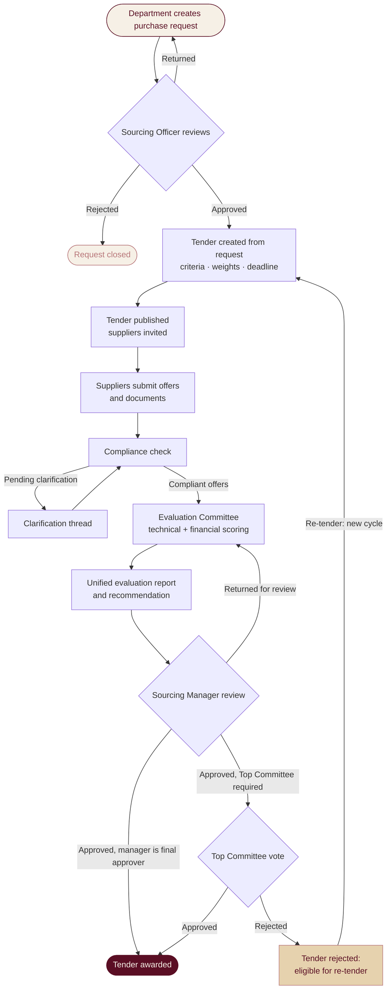

<div align="center">

# MS.WAND

### Sourcing & Tender Management System

**From purchase request to final award — one transparent, role-based procurement workflow for a cosmetics company.**

<br>


<br>

[**Overview**](#overview) &nbsp;·&nbsp;
[**Features**](#key-features) &nbsp;·&nbsp;
[**Roles**](#system-roles) &nbsp;·&nbsp;
[**Workflow**](#tender-workflow) &nbsp;·&nbsp;
[**Design**](#uiux-design--figma) &nbsp;·&nbsp;
[**Getting started**](#getting-started) &nbsp;·&nbsp;
[**Developer guide**](#developer-guide)

<br>

<a href="https://www.figma.com/design/THQWvk7lJmeY6CuJL6hZxL/MS.WAND-%E2%80%94-Mockups---Prototype?node-id=0-1"></a>
<a href="https://trello.com/b/9QmwEScR/supply-tender-team"></a>
<a href="docs-site/SourcingTender-Docs.html"></a>

</div>

---

> [!IMPORTANT]
> **AI assistants and developers: read [`AI_INSTRUCTIONS.md`](AI_INSTRUCTIONS.md) first.** Tasks and owners are in [`TASKS.md`](TASKS.md).

## Contents

- [Overview](#overview)
- [Highlights](#highlights)
- [Key features](#key-features)
- [System roles](#system-roles)
- [Tender workflow](#tender-workflow)
- [Technology stack](#technology-stack)
- [UI/UX design — Figma](#uiux-design--figma)
- [Project management — Trello](#project-management--trello)
- [Architecture and project structure](#architecture-and-project-structure)
- [Getting started](#getting-started)
- [Security and authentication](#security-and-authentication)
- [Developer guide](#developer-guide)
- [Documentation](#documentation)
- [Team](#team)

---

## Overview

**The problem.** In a cosmetics company, buying raw materials, packaging and services usually runs through emails, spreadsheets and quotations in different formats. Requests get lost, suppliers are compared unevenly, and it is hard to show *who* decided *what*, and *why*.

**The solution.** MS.WAND is an ASP.NET Core MVC platform that carries every purchase through one auditable path: a department raises a request, the sourcing team turns it into a tender, invited suppliers submit offers and documents, an evaluation committee scores them, and the decision is approved by the Sourcing Manager and — when required — the Top Committee. Every role works in its own dashboard and sees only what it is allowed to see.

## Highlights

| | |
|---|---|
| **8 role areas** | Admin, Requester, Sourcing, Supplier, Evaluation, Manager, Committee, plus a Shared area for every signed-in user |
| **End-to-end workflow** | Request → tender → offers → compliance → evaluation → manager review → committee vote → award |
| **Passwordless options** | Passkeys (fingerprint / Face ID / Windows Hello) and on-server face sign-in with liveness check |
| **Supplier isolation** | A supplier never sees another supplier's offer, price or documents |
| **Assistant, not decider** | Optional AI summaries and chat run on a local Ollama model by default; humans make every decision |
| **Traceability** | Audit log, notifications, clarifications and exportable reports |

## Key features

<table>
<tr>
<td width="50%" valign="top">

**Access and administration**
- Role-based dashboards with `[Authorize]` per area
- Employee accounts and department management
- Evaluation-committee configuration
- Supplier registration with admin review (approve, reject, suspend)
- Contact-message inbox and audit-log viewer

**Requests and tenders**
- Purchase requests with items, priority and review (approve, reject, return)
- Tender creation from approved requests, criteria and weights
- Supplier invitations and responses
- Re-tendering when a cycle must start again

</td>
<td width="50%" valign="top">

**Offers and evaluation**
- Supplier offers with line items, documents and drafts
- Watermarked document preview with access logging
- Compliance checks before evaluation
- Technical and financial scoring by the committee, side-by-side offer comparison and a unified evaluation report

**Decisions and collaboration**
- Sourcing Manager review of the committee recommendation
- Top Committee review package and voting
- Clarification threads, in-app notifications and email
- Reports with Excel and PDF export
- Voice search and an optional AI assistant

</td>
</tr>
</table>

> [!NOTE]
> A few screens in the source are still placeholders with no workflow yet: Sourcing **Tenders › Suppliers**, Evaluation **Financial**, Top Committee **Decisions** and **Statistics**, and the public **How It Works** page.

## System roles

| Role | Area | Responsibilities |
|---|---|---|
| **Admin** | `Areas/Admin` | Employees, departments, evaluation committee, supplier registrations, contact messages, audit logs |
| **Requesting Department** | `Areas/Requester` | Create and track purchase requests, respond to returned requests |
| **Sourcing Officer** | `Areas/Sourcing` | Review requests, create and publish tenders, invite suppliers, check compliance, compare offers, track evaluation, re-tender |
| **Supplier** | `Areas/Supplier` | Company profile and documents, invitations, prepare and submit offers |
| **Evaluation Committee** | `Areas/Evaluation` | Technical and financial assessment, recommendations, unified evaluation report |
| **Sourcing Manager** | `Areas/Manager` | Review evaluation reports and decide; forward to the Top Committee when required |
| **Top Committee** | `Areas/Committee` | Review the package, vote on the final decision, bid history |
| **Every signed-in user** | `Areas/Shared` | Onboarding, profile and security, notifications, clarifications, reports |

Role names come from [`Infrastructure/Roles.cs`](Project/TenderSystem/TenderSystem/Infrastructure/Roles.cs); status values from [`Infrastructure/Statuses.cs`](Project/TenderSystem/TenderSystem/Infrastructure/Statuses.cs).

## Tender workflow

The flow below follows the status values defined in `Infrastructure/Statuses.cs`.



<details>
<summary><b>Status values used along the way</b></summary>

| Entity | Statuses |
|---|---|
| Purchase request | Draft · Submitted · Under Review · Approved · Rejected · Returned · Converted to Tender |
| Tender | Draft · Published · Open · Closed · Under Evaluation · Awaiting Manager Review · Awaiting Committee Decision · Awarded · Cancelled · Rejected |
| Offer (bid) | Draft · Submitted · Under Review · Compliant · Non-Compliant · Accepted · Rejected · Withdrawn |
| Evaluation report | Recommendation Pending · Manager Approved · Manager Rejected · Returned for Review · Committee Approved · Committee Rejected |
| Supplier | Pending · Approved · Rejected · Suspended |
| Clarification | Pending · Answered · Resolved |

</details>

## Technology stack

| Layer | Technology |
|---|---|
| **Platform** | .NET 10 · ASP.NET Core MVC with Areas · Razor views |
| **Data** | Entity Framework Core 10 · SQL Server (LocalDB or Express) |
| **Identity and security** | ASP.NET Core Identity · Fido2 (passkeys / WebAuthn) · FaceAiSharp + ONNX Runtime (local face recognition) |
| **UI** | Bootstrap 5 · Bootstrap Icons · Cairo font |
| **Documents and reports** | DocumentFormat.OpenXml (Excel) · Aspose.PDF · PdfPig |
| **Messaging** | MailKit (SMTP email) |
| **Voice and AI** | Whisper.net (voice search transcription) · Ollama (local model, default AI provider) |
| **Configuration** | DotNetEnv (`.env` file) |

Package versions are pinned in [`TenderSystem.csproj`](Project/TenderSystem/TenderSystem/TenderSystem.csproj).

## UI/UX design — Figma

<div align="center">

<a href="https://www.figma.com/design/THQWvk7lJmeY6CuJL6hZxL/MS.WAND-%E2%80%94-Mockups---Prototype?node-id=0-1"></a>

</div>

The official high-fidelity mockups and clickable prototype live in **MS.WAND — Mockups & Prototype**. The Figma import passed its final technical verification:

| 81 | 11 | 92 | 9 | 642 |
|:---:|:---:|:---:|:---:|:---:|
| application screens | modal states | design items | role-based sections | native prototype links |

The visual identity follows the MS.WAND palette:


> The verification is technical: frame inventory, editable layers, ordering and link targets. It is not an independent usability or accessibility review.

## Project management — Trello

<div align="center">

<a href="https://trello.com/b/9QmwEScR/supply-tender-team"></a>

</div>

The team's Trello board organises tasks, tracks progress through each phase and keeps the seven developers coordinated. Task IDs and ownership are mirrored in [`TASKS.md`](TASKS.md).

## Architecture and project structure

A classic **ASP.NET Core MVC** application. Each role has its own **Area** (controllers, views, view models) and the dashboard layout; public pages and sign-in live in the root `Controllers/` and `Views/`. Business logic that several controllers share sits in `Services/<Feature>/`, each feature registering itself through an `IFeatureModule` instead of editing `Program.cs`.

```
Cosmetics-Management-System/             <- git repo root (.gitignore lives here)
  AI_INSTRUCTIONS.md  TASKS.md           rules and task ownership (read first)
  docs-site/                             team documentation website
  Project/TenderSystem/
    TenderSystem.slnx
    TenderSystem/                        the web project
      .env.example                       copy to .env (never committed)
      Program.cs
      Areas/        Admin · Requester · Sourcing · Supplier · Evaluation · Manager · Committee · Shared
      Controllers/  public pages, account, passkey, face, AI endpoints
      Views/        Home · Account · Shared (layouts, sidebars)
      Data/         ApplicationDbContext · Entities · DbSets · Configurations · Seed
      Infrastructure/  Roles · Statuses · options · DashboardRouter
      Services/     Ai · Audit · Auth · Biometrics · Clarifications · Committee · Email · Files · Notifications · Reports · Voice
      Migrations/   generated by EF Core
      wwwroot/      css · js · images
```

Layouts: `_PublicLayout` = navbar + big footer (everything in `Views/`). `_DashboardLayout` = sidebar + header + small footer (everything under `Areas/`, automatic). `_AuthLayout` is used for sign-in and supplier registration.

## Getting started

**Requirements:** **.NET 10 SDK**, **SQL Server** (LocalDB comes with Visual Studio, or Express), **git**.

```bash
git clone https://github.com/Supply-Tender-Team/Cosmetics-Management-System.git
cd Cosmetics-Management-System/Project/TenderSystem/TenderSystem

cp .env.example .env            # PowerShell: Copy-Item .env.example .env
#   open .env and check DB_CONNECTION matches YOUR SQL Server

dotnet dev-certs https --trust  # once per machine (passkeys and camera need HTTPS)
dotnet tool install --global dotnet-ef
dotnet run --launch-profile https
```

> [!WARNING]
> **In Development, starting the app changes your local database.** On startup it applies pending EF Core migrations (creating the database if it does not exist), creates one test account per role and seeds demo data. Point `DB_CONNECTION` at a local development database only.

Open **https://localhost:7180** (everybody uses the same port, so WebAuthn works the same everywhere; plain HTTP is on `http://localhost:5180`).
Sign in with the one-click buttons on the login page (Admin, Requesting Department, Sourcing Officer, Evaluation Committee, Sourcing Manager, Top Committee, Supplier). They appear in Development only; the accounts and their password come from the `SEED_*` keys in `.env.example`.

**Visual Studio:** open `Project/TenderSystem/TenderSystem.slnx`, select the **https** profile, press **F5**.

You do **not** edit `appsettings.json`, `launchSettings.json` or the `.csproj`. Your only local file is `.env`.

<details>
<summary><b>Testing on a phone (public tunnel)</b></summary>

<br>

Fingerprint and face login need HTTPS and a real host name. On your laptop `https://localhost:7180` is enough. For a phone, open a free Cloudflare tunnel:

```bash
winget install Cloudflare.cloudflared      # once
cloudflared tunnel --url http://localhost:5180
```

It prints a link like `https://random-words.trycloudflare.com`. Then:

1. Put that link in `.env`: `PUBLIC_URL=https://random-words.trycloudflare.com` (this is the **only** value to change).
2. Restart the app, open the link on the phone.
3. Check it: on your own machine open `https://localhost:7180/dev/public-url`. It shows which address emails and fingerprint login will use.

Notes: the link changes every time you start the tunnel (change `PUBLIC_URL` again, passkeys must be registered again). Share the link only with teammates. Through a tunnel the one-click sign-in panel and the `/dev/*` pages are hidden on purpose.
To go back to normal, set `PUBLIC_URL=https://localhost:7180`.

</details>

## Security and authentication

| Mechanism | What is stored | Notes |
|---|---|---|
| **Password** (ASP.NET Core Identity) | Hashed password | Lockout is shared with the biometric methods |
| **Passkeys** (Fido2 / WebAuthn) | Public key and a counter only | The fingerprint never leaves the device |
| **Face sign-in** (local AI) | Encrypted 512-number template (AES-256-GCM) | **No picture is ever saved**; processed on our own server |

Every user completes onboarding with **at least one** of fingerprint or face before a dashboard opens. Suppliers must never see another supplier's data; uploads use random file names under `App_Data/uploads`, never inside `wwwroot`. The optional AI assistant only **proposes**; humans decide.

<details>
<summary><b>Face sign-in — how to use it</b></summary>

<br>

* Enroll: sign in with your password, open `https://localhost:7180/Face`, press **Start face setup** and follow the instructions (straight, turn to one side, turn to the other). A protected template is saved, never a photo.
* Sign in ("smart"): on the login page leave the email EMPTY, press **Sign in with face**, just look straight at the camera (about 2 seconds). A small anti-photo model checks the face is live; if it is not sure, the camera automatically asks for one head turn to a random side (about 4 seconds more). The setup asks for both sides once. See `FACE_PASSIVE_LIVENESS` and `FACE_PASSIVE_MIN_REAL` in `.env.example`. The system recognises who you are among everybody enrolled. Type your email first for the strictest one-to-one check. Smart mode refuses ambiguous matches (two similar faces), throttles failed attempts per client address, and can be turned off with `FACE_ALLOW_IDENTIFY=false`. Set `FACE_LOGIN_TURNS=1` in `.env` for a faster sign-in that asks for one random side only.
* The camera works only on `https://` pages or `localhost`. On a phone use the tunnel (see *Testing on a phone*).
* If real people are rejected or accepted wrongly, tune `FACE_MATCH_THRESHOLD`, `FACE_YAW_TURN_MIN` and `FACE_YAW_CENTER_MAX` in `.env` and tell Wadea the numbers.
* Packages: `FaceAiSharp.Bundle` (detector, landmarks and ArcFace models, CPU only) and `Microsoft.ML.OnnxRuntime` (the native runtime; without it Windows loads an old system copy and crashes). `SixLabors.ImageSharp` is used under its Six Labors Split License (free for open source and non-commercial use).

</details>

<details>
<summary><b>Why our own face recognition (and not a cloud service like Face++)</b></summary>

<br>

Decision: we built face sign-in ourselves with local AI models (`FaceAiSharp`: SCRFD detector, ArcFace embeddings). A cloud service such as Face++ was considered because our coach suggested it. Remember these points for the presentation and the technical discussion.

| | Cloud service (Face++) | Our own (local) |
|---|---|---|
| Where faces are processed | On the vendor's servers, pictures travel over the internet | On OUR server, faces never leave it |
| What is stored | Depends on the vendor | Only an encrypted list of 512 numbers (AES-256-GCM). **No picture is ever saved** |
| Needs | Account, API key and secret, internet, usage limits or a paid plan | Nothing external, no key, no cost, works offline |
| Privacy and law | Employees' face images go to a third party abroad: consent, data residency and contract questions | Biometric data stays in our own database under our control |
| Anti-photo protection (liveness) | Strong anti-spoofing is a separate commercial product, usually via their mobile SDK. The plain compare API alone does not stop a photo | We check a REAL head movement on the server (straight, then both sides, random order, one-time challenge) |
| Dependence | Pricing, availability and rules can change | We control the code and the thresholds |

Advantages of our version (in short):
1. **Privacy by design**: no image is stored, templates are encrypted, nothing is sent to anybody.
2. **No cost and no key** to manage, works without internet.
3. **Meets the brief**: a static photo is NOT accepted as a face (guided head-turn liveness checked on the server).
4. **Two sign-in modes**: with the email (1:1, strictest) or with the email empty ("smart" 1:N: higher bar, a margin over the second person, throttled failures).
5. **Hardened**: one-time challenges, anti-forgery token, rate limits, lockout shared with the password, every attempt logged, safe messages that do not reveal which accounts exist.
6. **Tunable and testable**: all thresholds are in `.env` and the whole flow has automated checks.

Honest limits (say them before someone asks):
* It is a challenge-response liveness check, not a certified one: a replayed VIDEO of the real person turning could pass. A commercial liveness product (3D / depth, infrared) is stronger.
* The camera and lighting change the similarity: thresholds must be tuned with the real team and real phones.
* In "smart" mode the more people are enrolled, the higher the chance of a wrong match: raise `FACE_IDENTIFY_THRESHOLD` or ask for the email when the user base grows.
* Face data is personal data: keep the consent step in onboarding and a way to delete the saved faces.

If a cloud provider is ever required, add it behind the same `FaceService` (an alternative way to compute the embedding and the liveness), so the rest of the app does not change.

</details>

<details>
<summary><b>Fingerprint sign-in (passkeys)</b></summary>

<br>

* Set up: sign in with your password, open `https://localhost:7180/Passkey`, press **Set up on THIS device** (Windows Hello, Touch ID, phone fingerprint) or **Use my PHONE** (a QR code appears and you approve on the phone). Give the device a name. You can add several devices (laptop, phone) and remove any of them on the same page.
* Sign in: on the login page press **Sign in with fingerprint**. No email needed: the device offers your passkey, you unlock it with the fingerprint, done.
* What is stored: only a PUBLIC key (and a counter). The fingerprint itself never leaves the device, we never see it.
* Needs `https://` or `localhost`. For a phone, use the tunnel (see *Testing on a phone*). A passkey belongs to the address it was created on: `localhost` and the tunnel link are different, so set up again on each. In Development the app reads the address from the page; elsewhere it uses `PUBLIC_URL`.
* Limits: the browser cannot say WHICH biometric was used. A laptop without a fingerprint reader asks for the Windows Hello PIN or face instead. If the user has no screen lock at all, the device refuses to create a passkey.
* Tests: the registration, the sign-in and the attacks (wrong site, phishing origin, replay, cloned key, tampered signature, another user's handle, missing user verification) were tested with a software authenticator that behaves like a real device. A real fingerprint reader and a real phone still have to be tried by the team.

</details>

<details>
<summary><b>Local AI processing</b></summary>

<br>

The AI assistant, tender summaries and offer analysis use **one switch in `.env`**: `AI_CHAT_PROVIDER=ollama` runs a local model through Ollama (`OLLAMA_BASE_URL`, `OLLAMA_MODEL`). AI output is an assistant only and the UI says so; every AI-proposed action needs a fresh fingerprint or face approval, runs once and is audited. Details: [`Services/Ai/README.md`](Project/TenderSystem/TenderSystem/Services/Ai/README.md).

</details>

## Developer guide

<details open>
<summary><b>Where does my work go?</b></summary>

<br>

```
Areas/<Role>/Controllers + Views + Models     one folder per role dashboard
Controllers/ + Views/Home, Views/Account      public pages and login
Views/Shared/                                 layouts and sidebars (lead only)
Data/Entities/<Feature>/                      your entity classes
Data/Configurations/                          your IEntityTypeConfiguration<T> files
Data/DbSets/ApplicationDbContext.<Feature>.cs your DbSet properties
Services/<YourFeature>/                       your services + one IFeatureModule class
Migrations/                                   generated by EF
```

| Dev | Owns |
|-----|------|
| 1 (lead) | Layouts, Program.cs, Infrastructure, migrations, merging |
| 2 | Login, passkeys (fingerprint), face login, Shared/Onboarding |
| 3 | Public pages, Admin area, supplier registration and approval |
| 4 | Requester + Sourcing areas |
| 5 | Supplier area (bids, uploads) |
| 6 | Evaluation + Manager + Committee areas, Ollama AI |
| 7 | Clarifications, Notifications, Reports, Audit log, voice search, optional features |

The current, named ownership table is in [`AI_INSTRUCTIONS.md` § 4](AI_INSTRUCTIONS.md#4-who-owns-what) and [`TASKS.md`](TASKS.md); when they differ from the table above, those files win.

</details>

<details open>
<summary><b>Rules that prevent merge conflicts</b></summary>

<br>

1. Branch per task, created from `dev`: `feature/<ID>-<short-name>` (or `fix/<ID>-<short-name>`). Never commit or push directly to `dev` or `main`; open a pull request into `dev`.
2. Only edit your own files. Shared files (`Program.cs`, `Views/Shared/*`, `ApplicationDbContext.cs`, `site.css`, `README.md`, …) belong to the lead.
3. No `DbSet` in `ApplicationDbContext.cs`: use your partial file in `Data/DbSets/` and your mapping class in `Data/Configurations/`.
4. Register services in your own `IFeatureModule` class, not in `Program.cs`.
5. Migrations: **only Wadea creates and commits migrations.** Push your entity change without any `Migrations/` file and tell him (details in [`AI_INSTRUCTIONS.md` § 10](AI_INSTRUCTIONS.md#10-database-and-migrations) and `TASKS.md` § 7b).
6. Pull `dev` into your branch every morning. Small pull requests, one reviewer.
7. Never commit `.env`, `bin/`, `obj/`, `.vs/`, `*.user` or uploaded files (all in `.gitignore`).

</details>

<details>
<summary><b>Before you ship a page</b></summary>

<br>

- Keep the `[Authorize(...)]` attribute of your controller switched on (use the constants in `Infrastructure/Roles.cs`).
- Server-side validation with Data Annotations on every form; `[ValidateAntiForgeryToken]` on every POST.
- Suppliers must never see another supplier's data.
- Run `dotnet build` with 0 errors and test the normal path and one invalid-input path.

</details>

## Documentation

| Resource | Contents |
|---|---|
| [`docs-site/SourcingTender-Docs.html`](docs-site/SourcingTender-Docs.html) | Team documentation website (open in a browser): schema, ER, SQL, flow story, pages |
| [`docs-site/database/schema.sql`](docs-site/database/schema.sql) | Database design: table and column names to follow |
| [`AI_INSTRUCTIONS.md`](AI_INSTRUCTIONS.md) | How the team works: ownership, shared files, `.env`, UI rules, migrations, Git workflow |
| [`TASKS.md`](TASKS.md) | Every task, owner, phase and dependency |
| [`Services/Ai/README.md`](Project/TenderSystem/TenderSystem/Services/Ai/README.md) | AI assistant, providers and the propose → approve → execute-once pipeline |

## Team

<div align="center">

Designed and built by the **Supply Tender Team** — seven developers working in parallel on one repository, coordinated through [`TASKS.md`](TASKS.md), [Trello](https://trello.com/b/9QmwEScR/supply-tender-team) and pull-request reviews.

<sub>MS.WAND · Sourcing & Tender Management System</sub>

</div>
